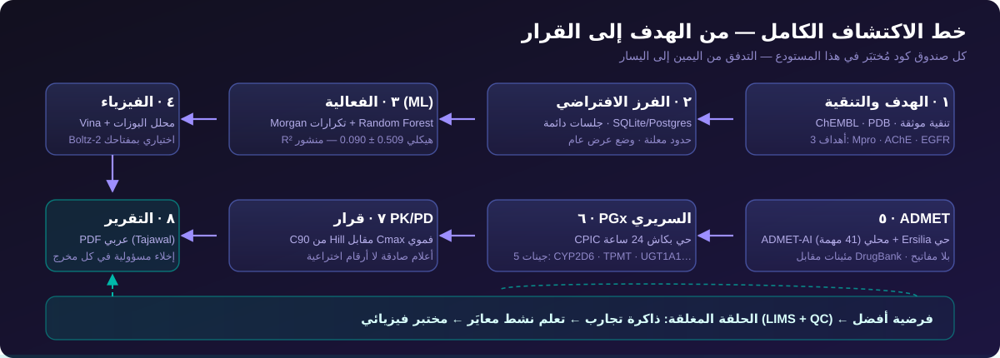

<p align="center">
  
</p>

# 🧬 Pharma SDL — مختبر الفارما الذاتي

> **«من الكتاب إلى الكود — من النظرية إلى الاكتشاف»**
>
> منصة عربية مفتوحة تجمع **خط اكتشاف كاملاً** — تنقية ← فرز افتراضي ← فعالية ML ←
> فيزياء ربط ← ADMET ← صيدلة جينية ← قرار PK/PD ← تقرير عربي — بلا اشتراكات،
> وبلا مفاتيح، و**بكل رقم مصدره معلن وتدهوره صادق**.

<p align="center">
  <a href="https://github.com/tibatechapp-ship-it/pharma-sdl/releases"></a>
  <a href="https://github.com/tibatechapp-ship-it/pharma-sdl/actions/workflows/tests.yml"></a>
  <a href="https://github.com/tibatechapp-ship-it/pharma-sdl/actions/workflows/tests.yml"></a>
  <a href=".github/workflows/platform.yml"></a>
  <a href="LICENSE"></a>
  
  
</p>

---

## ✨ لماذا هذه المنصة مختلفة؟

| # | الخندق | ماذا يعني عملياً |
|---|--------|------------------|
| ١ | **خط كامل بلا تسجيل** | توليد ← ربط ← ADMET ← PGx ← قرار — كل مرحلة تعمل محلياً بلا حساب ولا مفتاح |
| ٢ | **عربية أولاً بثنائية كاملة** | واجهة وتقارير PDF ودروس «لماذا يهم سريرياً» بالعربية، مع مبدّل إنجليزي حي |
| ٣ | **صفر اشتراكات** | كل تكامل خارجي إما مجاني بلا مفتاح (PubChem · CPIC · RxNorm) أو له بديل محلي مبني هنا |
| ٤ | **مصدر كل رقم معلن** | ثلاثة مسارات درجات لا تُخلط، محرك كل تنبؤ يُعلَن، وغياب الخدمة = مرجعية موثقة لا رقم مختلق |
| ٥ | **القياس العلني** | بروتوكول تقييم منشور (عشوائي + 5 بذور هيكلية + خطوط أساس) وأرقام مُجمَّدة قابلة لإعادة الإنتاج |
| ٦ | **حلقة فيزيائية صادقة** | عقد REST لمختبر حقيقي (LIMS + أجهزة QC) — القياس الحقيقي قرار بشري موثق لا محاكاة صامتة |

<p align="center">
  
</p>

---

## ⚡ جرّبها في 60 ثانية

```bash
pip install -r requirements.txt -r requirements-dev.txt

# بوابة الـAPI مع توثيق تفاعلي
uvicorn pharma_sdl.api.app:create_app --factory --port 8000
#   → http://localhost:8000/docs

# أو من سطر الأوامر مباشرة
pharma-sdl engines
pharma-sdl targets
pharma-sdl screen --target 7VH8_A --ligands data/demo_ligands.csv --top 10

# أو بالحاويات (API على :8000 + لوحة على :8501)
docker compose up --build
# أو مع PostgreSQL حي (عقد ADR-0008 نفسه):
docker compose --profile pg up --build
```

نداء فرز حي (وضع العرض — 24 جزيء جاهزون):

```bash
curl -s -X POST localhost:8000/api/v1/screening/runs \
  -H 'Content-Type: application/json' -d '{"target_id": "7VH8_A", "top_n": 5}'
# → 202 {"job_id": "...", "run_url": "..."} ثم:
curl -s localhost:8000/api/v1/screening/runs/<job_id> | python3 -m json.tool
curl -s "localhost:8000/api/v1/screening/runs/<job_id>/report?lang=ar"
```

> 🖥️ **الواجهة التفاعلية**: `streamlit run app.py` — 16 مختبراً تفاعلياً بالعربية في 4 مجموعات.
> 🌐 **دليل المنصة (GitHub Pages)**: <https://tibatechapp-ship-it.github.io/pharma-sdl/>
> 📣 **Live Demo عام**: قيد النشر — بانتظار قرار النشر (كل شيء جاهز: `PHARMA_SDL_ENV=production` يفرض مفاتيح API تلقائياً).

---

## 🖥️ مختبرات المنصة — 16 تبويباً في 4 مجموعات

| المجموعة | التبويبات |
|----------|-----------|
| **خط التوليد** | 🏭 Make — توليد SMILES بـ RDKit · 🔬 Test — محاكاة hERG + LDL-C · 🧠 Analyze — تعلم نشط (UCB + Pareto) · 🧬 PROTAC |
| **المختبرات السريرية** | 💊 MIC Lab — PK/PD للمضادات · 🎯 PROTAC Lab — Hook Effect · 🧫 CYP2C19 — طب شخصي CPIC · 💊 PGx — 5 جينات حية من CPIC · 🌍 الصحة العالمية — الملاريا والسل (Ersilia) |
| **الأدوات** | 🔌 PubChem — بيانات حية مخزّنة · 🤖 Predict — تنبؤ pIC50 بتعلم آلي · 🧲 Docking — Vina + Meeko + عرض 3Dmol + محرك تسجيل ثانٍ محلي |
| **التقارير** | 🎓 Capstone — الخط الكامل من الهدف إلى القرار · 🧪 ADMET Hub — ADMET-AI محلي (41 مهمة) ↔ Ersilia حي · 🗂️ التصنيف الدوائي — ATC بـ23 مجموعة · 🛡️ التحقق الخارجي — بطاقات نماذج بفترات ثقة + قياس متبادل ADMETlab 3.0 |

كما تتضمن المنصة: 🌱 توسيع المكتبة (PubChem تشابه / BRICS محلي) · 🎯 التوليد الموجّه بالهدف
(مكافئ ChatChemTS محلي 100%) · ⚙️ القراءة التلقائية (خط كامل بنقرة واحدة) ·
🌐 تحقق Boltz-2 اختياري بمفتاحك · مبدّل عربي/إنجليزي يغطي كل المخرجات.

---

## 🗺️ رحلة البناء — P0 إلى P16 (كل مرحلة إصدار مُجمَّد)

| المرحلة | الإصدار | المخرج | الدليل |
|---------|---------|--------|--------|
| P0–P1 | v0.2.0 | النقلة النوعية: منصة API-First مُختبَرة بالكامل | [تدقيق P0](docs/audit/REPRODUCIBILITY-P0.md) |
| P2 | v0.3.0 | هوية بشرية للاعتماد + منصة دائمة + قبول هندسي | ADR-0002 |
| P3 | v0.4.0 | تخزين حي: SQLite/Postgres بنفس العقود (ADR-0008) | ADR-0007/0008 |
| P4 | v0.5.0 | تعلم نشط بيقين مُعايَر (conformal) | [تدقيق الحملة](docs/audit/ACTIVE-LEARNING-CAMPAIGN.md) |
| P5 | v0.6.0 | مكتبة الطب النبوي بعقود الصدق | ADR-0010 |
| P6 | v0.7.0 | ثلاثة أهداف بنفس الكود: Mpro · AChE · EGFR | ADR-0011 |
| P7 | v0.8.0 | مقاييس صدق الأهداف تُقاس وتُنشر | [مقاييس الجودة](docs/audit/TIBB-QUALITY.md) |
| P8 | v0.9.0 | جسر الفيزياء: عقد دفعات REST للمختبر | ADR-0013 |
| P9 | v0.10.0 | بوابة LIMS مرجعية + مسار قياسات للذاكرة | ADR-0014 |
| P10 | v0.11.0 | طبقة الأجهزة + مراقب جودة القراءات + الحوكمة | ADR-0015 |
| P11 | v0.12.0 | ترقية النموذج: A/B/C/D على البروتوكول المنشور | [تقرير P11](docs/audit/MODEL-UPGRADE-P11.md) |
| P12 | v0.13.0 | القياس الخارجي الرسمي على TDC admet_group | [تقرير P12](docs/audit/MODEL-BENCHMARK-TDC-P12.md) |
| P13 | v0.14.0 | ADMET-AI: مركز ADMET من نموذجين إلى 41 مهمة | [تقرير P13](docs/audit/MODEL-ADMET-AI-P13.md) |
| P14 | v0.15.0 | المقارنة ثلاثية الطبقات: ML ← Vina ← Boltz-2 | [تقرير P14](docs/audit/STRUCTURE-TIERS-P14.md) |
| P15 | v0.16.0 | الصحة العالمية: الملاريا والسل بقمع قرار ثلاثي | [تقرير P15](docs/audit/GLOBAL-HEALTH-P15.md) |
| P16 | v0.17.0 | تحصين النشر: بوابة مصادقة الإنتاج (ADR-0016) | ADR-0016 |
| تدقيق | v0.17.1 | تقييم شامل: فحص الإقلاع الميت + 39 ملاحظة lint | [CHANGELOG](CHANGELOG.md) |
| P18 | v0.18.0 | مركز التحقق الخارجي: عميل ADMETlab 3.0 + بطاقات نماذج | [ADR-0017](docs/adr/ADR-0017-external-validation-center.md) |
| تدقيق | v0.18.1 | معالجة الثغرات: 503 صادقة + إصلاحات تدقيق الكود والوثائق | [CHANGELOG](CHANGELOG.md) |

---

## 🔬 الأرقام الصادقة — ما الذي نقيسه فعلاً؟

> كل رقم أدناه محسوب فعلاً بسكربت مجرّد في المستودع، والتجميد الحي في
> [`docs/audit/`](docs/audit/) — لا أرقام ادعائية في هذه الصفحة.

### 🤖 Model Card — نموذج الفعالية المعتمد (v0.12.0، الذراع D)

| البند | القيمة |
|---|---|
| البيانات | قياسات IC50 حقيقية لـ SARS-CoV-2 Mpro (CHEMBL4523582) — 900 جزيء، وسيط pchembl، نظيفة من القياسات المشكوك |
| الميزات | **بصمة Morgan بالتكرارات** (radius=2، 2048 بت) |
| النموذج | RandomForestRegressor (300 شجرة، `max_features=0.3`، seed=42) |
| **R² عشوائي** | 0.468 |
| **R² هيكلي** (5 بذور Scaffold Split) | **0.508 ± 0.090** — يتفوق على المرتكز في كل بذرة |
| MAE هيكلي | 0.559 (وحدة log) |
| عدم اليقين | تباين الأشجار — إشارة نسبية غير معايَرة تجريبياً |
| خط الأساس | أقرب جار Tanimoto معمّم — يُلغى التفوق الوهمي قبل الاحتفال |

**نتائج سلبية موثقة** (ننشرها كما هي): إضافة الوصف الفيزيوكيميائي لم تفُع
(R² 0.472) وHistGradientBoosting خسر (0.429) — والهدف الخمسي (0.55) لم يتحقق
عند n=900؛ سقف التمثيل ≈ 0.51 والرافعة الحقيقية تنويع البيانات. التفاصيل:
[تقرير P11](docs/audit/MODEL-UPGRADE-P11.md) والتقييم الخارجي:
[القياس على TDC](docs/audit/MODEL-BENCHMARK-TDC-P12.md).

### ✅ جودة هندسية

| المؤشر | القيمة | المصدر |
|---|---|---|
| الاختبارات | **767 ناجحاً** + 3 تكاملاً منفصلاً بالتوسيمة | `pytest -m "not integration"` |
| Lint | ruff نظيف — 0 ملاحظة على 334 ملفاً | `ruff check .` |
| CI | Tests ✓ + Platform ✓ + Pages ✓ — شارة حية من التشغيل الفعلي | [.github/workflows](.github/workflows/) |
| الإقلاع الآمن | بورت/حدود/خلفية تخزين غير صالحة = رفض إقلاع مُعلَّل | `Settings.validate()` (ADR-0016) |
| الإنتاج | `PHARMA_SDL_ENV=production` بلا مفاتيح = لا إقلاع | `create_app()` |

---

## 🧭 للمطوّرين

```bash
# الاختبارات الكاملة (بلا شبكة)
python3 -m pytest -m "not integration" -q

# جودة الكود
python3 -m ruff check .

# التقييمات العلمية القابلة لإعادة الإنتاج
python3 scripts/evaluate_generalization.py   # ~80 ثانية → JSON
python3 scripts/build_audit_report.py        # JSON → التقرير
```

| المستند | المحتوى |
|---------|---------|
| [docs/ARCHITECTURE.md](docs/ARCHITECTURE.md) | معمارية المنصة الكاملة |
| [docs/adr/](docs/adr/) | 17 قراراً معمارياً موثقاً (ADR-0001 → ADR-0017) |
| [docs/audit/](docs/audit/) | تقارير التقييم المستقلة والأرقام المجمّدة |
| [docs/INTEGRATION-ROADMAP.md](docs/INTEGRATION-ROADMAP.md) | سجل دمج كل أداة خارجية وقرار كل فرع |
| [docs/STRATEGY-2026.md](docs/STRATEGY-2026.md) | المقارنة الصريحة بالمنافسين وموقعنا |
| [HANDOFF.md](HANDOFF.md) | القرارات البشرية المعلقة (جهاز · مفتاح · نشر) |
| [CONTRIBUTING.md](CONTRIBUTING.md) · [SECURITY.md](SECURITY.md) | المساهمة والإبلاغ الأمني |

---

## ⚠️ الحدود — معلنة لا مدفونة

- **تعليمية لا سريرية**: كل مخرج يحمل إخلاء مسؤولية — المنصة تدريب على منهجية
  الاكتشاف، لا توصية علاجية ولا بديل عن تجارب مخبرية.
- **نموذج الفعالية**: بيانات فحص واحد (Mpro) وميزات ثنائية الأبعاد فقط — لا يُستخدم
  لقرارات خارج هذا النطاق.
- **الطبقة البنيوية**: Boltz-2 يتطلب GPU (دفتر Colab جاهز) ومفتاح المستخدم —
  باقي المنصة تعمل بلا شبكة إطلاقاً.
- **النداءات الحية** (PubChem · CPIC · RxNorm · Ersilia) موسومة `integration` في
  الاختبارات، وتفشل بتدهور صادق موثق لا بأرقام مختلقة.

---

<p align="center">
  <sub>رخصة MIT · بُنيت لتعلّم صيدلة رقمي عربي · <b>«الجودة تُقاس وتُنشر، لا تُدَّعى»</b></sub><br>
  <a href="https://tibatechapp-ship-it.github.io/pharma-sdl/">دليل المنصة</a> ·
  <a href="CHANGELOG.md">سجل الإصدارات</a> ·
  <a href="docs/adr/">قرارات التصميم</a>
</p>
