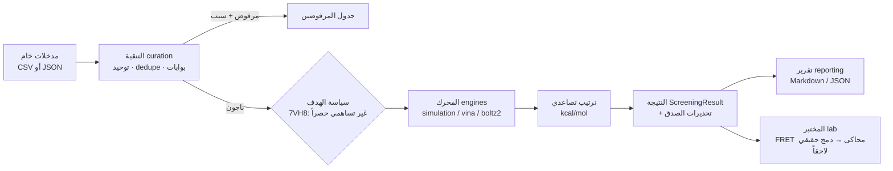

# معمارية المنصة — Pharma SDL v0.2.0 (API-First)

> **المنطق الحاكم:** التطبيق التعليمي (Streamlit) هو *واجهة* فوق منصة؛ المنصة هي
> التي تبقى وتتوسع. كل قدرة تُبنى أولاً كمكوّن مستقل بعقد واضح، ثم تُعرَض عبر
> الـAPI — فتصلح للوحة، وسطر الأوامر، والعميل الخارجي، ومختبر التشغيل الآلي.

## الخريطة — 9 وحدات

| # | الوحدة | المسار | العقد | الحالة |
|---|--------|--------|-------|--------|
| 1 | الكيمياء الحاسوبية | `pharma_sdl/chemistry/` | توحيد + واصفات + فلاتر أمان | ✅ عامل |
| 2 | إدارة الأهداف | `pharma_sdl/targets/` | سجل أهداف + سياسات صريحة | ✅ عامل (7VH8 · 7CMD) |
| 3 | المحركات | `pharma_sdl/engines/` | `DockingEngine` Protocol + سجل | ✅ عامل (simulation · vina · boltz2) |
| 4 | التنقية | `pharma_sdl/curation/` | CSV/مضمن → تقرير مسبَّب | ✅ عامل |
| 5 | الفرز الظاهري | `pharma_sdl/screening/` | `run_screening()` — الهيكل الهزّ | ✅ عامل |
| 6 | الإجماع العلاجي | `pharma_sdl/affinity/` | جسر Cheng-Prusoff | ✅ عامل |
| 7 | المختبر الذاتي | `pharma_sdl/lab/` | `LabClient` Protocol (FRET محاكى) | 🧪 مقبس جاهز للدمج |
| 8 | التقارير | `pharma_sdl/reporting/` | Markdown/JSON ثنائي اللغة | ✅ عامل |
| 9 | بوابة الـAPI | `pharma_sdl/api/` | FastAPI + طابور مهام + OpenAPI | ✅ عامل |

**القطع العرضية:** `config.py` (إعدادات البيئة) · `errors.py` (أخطاء موحّدة → HTTP) ·
`models.py` (عقد Pydantic واحد) · `jobs/runner.py` (طابور داخلي) · `security` ضمن
التنقية (بوابة التساهمية + PAINS) وضمن السياسات (لا مفاتيح في الكود — SECURITY.md).

## تدفق الفرز الظاهري (المسار الرئيسي)



## طبقة المحركات — التبديل بلا تعديل الخط

| المحرك | النوع | التوفر | ملاحظة الصدق |
|--------|------|--------|---------------|
| `simulation` | درجات حتمية | دائماً | `method=simulation` في كل نتيجة — للتطوير والCI والعرض |
| `vina` | ربط فعلي | vina+meeko محلياً | نفس المستقبلات المُتحقق منها (self-dock) في `data/receptors/` |
| `boltz2` | تقارب مباشر | بوابة `PHARMA_SDL_BOLTZ2_ENDPOINT` أو حزمة محلية | عقد HTTP موثّق في docstring الوحدة |

إضافة محرك جديد = كلاس ينفّذ `available()` + `score()` + سطر في
`engines/registry.py::_build_registry()` — لا شيء آخر يتغير.

## سياسة الأهداف (مصدر الحقيقة: الخطة v1.1)

- **7VH8 (Mpro):** غير تساهمي حصراً — Vina وBoltz-2 لا يمثّلان الترابط التساهمي؛
  أي رأس تساهمي (أكريلاميد، ألدهيد، نيتريل، …) يُرفض في التنقية مسبَّباً.
- **7CMD (PLpro):** نفس المنطق حتى وصول محرك يدعم التساهمي.
- السياسة تقرأها كل الطبقات من `targets/registry.py::POLICIES` — ولا يمكن لطلب
  API تجاوزها (لا حقل "تجاهل الفلاتر" بالتصميم).

## المهام غير المتزامنة

`POST /screening/runs` يقبَل فوراً (202) وينفَّذ في طابور خيوط داخلي؛ الحالة عبر
`GET /screening/runs/{id}` والتقرير عبر `/report`. الترقية إلى Celery/Redis عند
تعدد المستخدمين تكون محصورة في `jobs/runner.py` (ADR-0005).

## التشغيل

```bash
# تطوير
pip install -r requirements.txt -r requirements-dev.txt
uvicorn pharma_sdl.api.app:create_app --factory --reload --port 8000

# سطر الأوامر
python -m pharma_sdl.cli screen --target 7VH8_A --ligands data/demo_ligands.csv --top 10

# إنتاج (Docker)
docker compose up --build        # API على :8000 + لوحة Streamlit على :8501
```

## مواءمة الخطة الاستراتيجية

| بند الخطة v1.1 | أين نُفِّذ |
|---|---|
| الهيكل الهزّ (نهاية الشهر الرابع) | `screening/runner.py` + `POST /api/v1/screening/runs` — **مُنجز في v0.2.0** |
| Boltz-2 المحرك الأساسي | `engines/boltz2.py` (ADR-0001) — بوابة جاهزة |
| Mpro غير تساهمي | `targets/registry.py::POLICIES` + بوابة الرؤوس التساهمية (ADR-0003) |
| Curation ~50–70% من الجهد | `curation/` بأسباب مرفوضة بلغتين — بذر خط السنة الأولى |
| قياسات الجودة (KPI) | عدّادات كل جولة في `ScreeningResult.counts` + تقارير قابلة للأرشفة |
| مختبر Q3/Q4 | `lab/` بقبّة `LabClient` — استبدال المحاكى بالحقيقي بلا تغيير أعلى |

الوثيقة الكاملة: `docs/plan/PharmaSDL_Strategic_Plan_v1.1.pdf`
